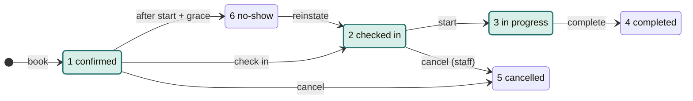
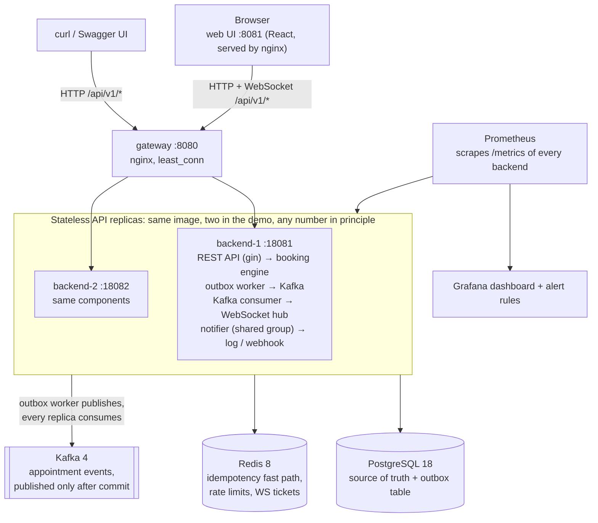
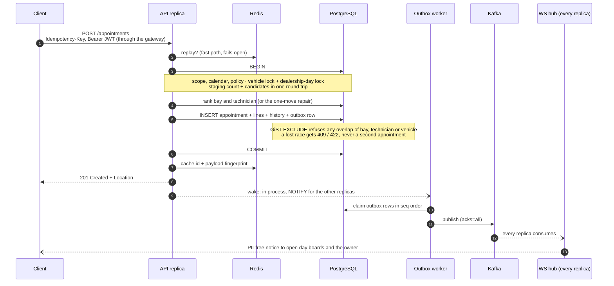

# System Design — Unified Service Scheduler (Scenario A)

Keyloop Technical Assessment — **Backend-focused** implementation with a thin React client for demo. Ambiguous requirements are listed under [Assumptions](#assumptions-ambiguity).

The slides shown in the video, [docs/slides.pdf](slides.pdf), are a presentation view of this document; where they differ, this document is authoritative.

## Summary (one page)

**Problem.** Book a vehicle into a dealership workshop. A service bay and a qualified technician must both be free for the whole job, and two bookings must never hold the same bay, technician or vehicle at the same time, even when two API servers race.

**Scope.** The backend is the implemented layer: a Go REST API on PostgreSQL, contract in OpenAPI. The React app is the client harness. Where the brief was unclear, the choice is written down under [Assumptions](#assumptions-ambiguity).

**Architecture.** Nginx gateway → stateless Go API replicas (two in the demo, any number in principle) → PostgreSQL as the only source of truth, Redis for idempotency and rate limits, Kafka for events published from a transactional outbox → a WebSocket hub on every replica for the live day board. Prometheus and Grafana for metrics and alerts. Diagram: [Architecture](#architecture).

**Key decisions**

| Decision | Chosen | Rejected | Why |
|---|---|---|---|
| Double-booking guarantee | GiST exclusion constraints on `tstzrange` for bay, technician and vehicle, over the holding statuses | Application lock, Redis lock, `SELECT … FOR UPDATE` | Only the database sees every writer. A row lock does not protect a time range. It stays correct even if the engine has a bug. |
| Events | Outbox row in the booking transaction; a worker publishes to Kafka after commit | Publishing to Kafka inside the request | A dual write can lose an event, or announce a booking that rolled back. |
| Scaling | Stateless replicas behind a gateway | Sticky sessions, in-memory state | Adding a replica does not split data. |
| Contention | One advisory lock per dealership-day, plus an in-process admission gate | GiST alone | GiST alone deadlocked on a full day of mixed jobs (p99 6.1 s → 105 ms with the lock). See [Guarantees](#guarantees). |
| Retries | `Idempotency-Key` with a durable unique index; Redis only speeds up replay | Redis as the source of truth | Booking keeps working with Redis down (`TestBookingSurvivesRedisOutage`). |

**Data flow (book).** `POST /appointments` → check scope, calendar and dealership policy → pick a bay (own type first, documented fallbacks) and a technician (all skills, sufficient level, on shift, best fit) → if nothing is free, move at most one confirmed job that has not started → insert under the day lock, where GiST rejects any overlap → outbox row in the same transaction → commit → Kafka → every replica pushes to its WebSocket clients; customer notifications come from the same events. Details: [Data flow](#data-flow-book).

**Observability.** JSON logs with request ID and instance; Prometheus metrics for HTTP, bookings, DB pool, outbox and notification backlog, and dependency health; a Grafana dashboard; alert rules. Tracing is designed (OpenTelemetry, trace context carried through the outbox and Kafka) but not shipped. Details: [Observability](#observability).

**Verification.** Unit tests for the allocation rules; integration tests on real Postgres and Redis under `-race` (many clients on one slot → exactly one winner); a stress run whose requirements matrix is judged by an independent SQL oracle; a capacity bench; chaos runs with Redis stopped and Kafka paused.

**Next.** Phase 2 domain work, platform scaling, the contingency plan and AI integration: [docs/roadmap.md](roadmap.md).

## Requirements → mechanism → proof

| Brief | Endpoint | Mechanism | Proof (tests) |
|---|---|---|---|
| **R1** request an appointment for a vehicle, service type, dealership and time | `POST /api/v1/appointments` (`dealershipId`, `vehicleId`, `serviceTypeId` or 1–5 `serviceTypeIds`, `startAt` RFC 3339) | `booking.Service.Book` (`booking/book.go`): scope and ownership, calendar and policy, job lines combined into one requirement (`requirement.go`) | `TestMultiLineAppointment`, `TestBookAssignsCustomerFromVehicle`, `TestHTTPCustomerSelfServiceFlow` |
| **R2** a bay and a qualified technician free for the **whole** duration, checked before confirming | `GET /availability`, `GET /availability/next` (read); the booking re-checks inside its transaction | Candidate SQL over `[start, end)` (`store/allocation.go`): bay fit, every skill at the minimum level, on duty for the whole window; GiST exclusion rejects any overlap at insert | `TestBookingRefusedWhenResourceBusyOnlyInSecondHalf`, `TestExclusionConstraints`, `TestSlotBurst`, `TestAvailabilityMatchesBookingForEverySlot`, `TestOracleAgreesWithAvailability` |
| **R3** a persistent record linking customer, vehicle, technician and bay | `201` + `Location`; `GET /appointments/{id}` | One transaction writes `appointments` (+ lines, history, outbox); customer taken from the vehicle, never from the client | `TestCreatedEventPayloadMatchesAppointment`, `TestBookedSnapshotSurvivesCatalogChange`, `TestSchemaHoldsTheBookingIntegrity` |

The quality goals (concurrency, stateless replicas, performance, reliability, optimisation, observability, many users) and their stress thresholds: [docs/testing.md](testing.md#requirements-matrix-tests-and-thresholds).

## Data model

```
dealerships ─┬─< service_bays            customers ─< vehicles (VIN unique)
             ├─< technicians ─< technician_skills / technician_shifts / technician_absences
             └─< dealership_hours, dealership_closures
service_types (catalog)

appointments ── dealership, customer, vehicle, service_bay, technician, [start_at, end_at), status,
   │            booked snapshot (duration, bay type, skills, level), version, idempotency key
   ├─< appointment_lines     (1–5 job lines, snapshotted names and durations)
   ├─< appointment_history   (audit: one row per change, same transaction)
   └── outbox_events         (one row per change, same transaction → Kafka)
```

Not shown: `users` and `auth_sessions` (accounts and refresh tokens), `notifications` (the customer message queue).

The guarantee is three exclusion constraints on `appointments` (`001_schema.sql`), active only for the holding statuses 1 confirmed, 2 checked-in, 3 in progress:

```sql
EXCLUDE USING gist (service_bay_id WITH =, tstzrange(start_at, end_at, '[)') WITH &&) WHERE (status IN (1, 2, 3))
EXCLUDE USING gist (technician_id  WITH =, tstzrange(start_at, end_at, '[)') WITH &&) WHERE (status IN (1, 2, 3))
EXCLUDE USING gist (vehicle_id     WITH =, tstzrange(start_at, end_at, '[)') WITH &&) WHERE (status IN (1, 2, 3))
```

Lifecycle (highlighted: the holding statuses the constraints cover). Check-in runs from the appointment's day until its booked end; a customer cancels only a confirmed booking before the dealership's change cutoff; reinstate is a late arrival before the booked end, re-held under GiST. Rules: [backend/AGENTS.md](../backend/AGENTS.md) rule 9.



Composite foreign keys (same file) also tie the bay and the technician to the appointment's dealership, so the record cannot associate resources of another workshop even through a script.

## Architecture



API contract: **OpenAPI 3** at `GET /api/v1/openapi.yaml` · Swagger UI `GET /api/v1/docs`.

Compression is done in the backends, not the gateway: nginx weakens a strong `ETag` when it compresses, and `If-Match` needs the strong `"3"` back (`parseIfMatch` refuses `W/"3"`, RFC 9110), so the gateway passes bodies through as they are. The web UI's nginx serves assets gzipped at build time (`gzip_static`); content-hashed `/assets/` files are cached `immutable` for a year and `index.html` is `no-cache` (revalidated by ETag), so a deploy reaches open browsers on their next load.

## Components

| Piece | Role |
|---|---|
| `httpapi` | REST + JWT auth (user + session read through a 5 s per-instance cache) + role routes + ETag/If-Match + embedded OpenAPI/Swagger + response compression (bodies ≥ 1 KiB, zstd preferred then gzip per `Accept-Encoding`, `Vary` set; never `/api/v1/auth/*` (tokens: BREACH), `/api/v1/ws/`, `/metrics`) |
| `booking` | Slot grid + "first available" search, dealership calendar (weekday hours, closures), multi-line job requirements, roster-aware bay/tech allocate (best-fit bays), staging windows/lunch, per-dealership policy, ownership + dealership scope, lifecycle (pull-ahead start), in-place reschedule, reassign, extend, no-show/reinstate, overrun sweep, audit history |
| `store` | pgx SQL, GiST-aware inserts, versioned config updates, rosters, provisioning (dealerships, bays, technicians), outbox lease/backoff, wake-ups after commit (in process + LISTEN/NOTIFY), notification queue, bounded lock/statement timeouts |
| `notify` | Customer confirmations, change notices, 24 h / 2 h reminders: enqueued idempotently from Kafka (shared consumer group) and a reminder sweep; lease-based sender (log, or webhook to an SMS/email gateway) |
| `auth` | bcrypt passwords; short-lived HS256 JWT access tokens (15 min) kept in memory by the web app; opaque refresh tokens (only their SHA-256 stored) rotated on every use in an `HttpOnly; SameSite=Strict` cookie, with reuse detection (RFC 9700); CSRF guards on cookie endpoints; every session time on the database clock. Details: [decisions → auth sessions](decisions.md#auth-sessions-and-csrf) |
| `cache` | Redis idempotency fast path (id + payload fingerprint per user), rate limits (one Lua script per request over every bucket; emails only as a keyed pseudonym) and single-use WS tickets; every call bounded by a 100 ms timeout and failing open, except the login/register limits, which fall back to a per-instance in-memory counter while Redis is down; the server starts with Redis down (readiness `degraded`) unless `REDIS_REQUIRED=true` |
| `worker` | Outbox → Kafka (woken right after a commit: in process on this instance, by NOTIFY on the others; batched, claimed in `seq` order with one in-flight event per aggregate, retry with capped backoff); maintenance (lease reclaim, reminder sweep, no-show sweep, overrun auto-extend one job per TX, batched purge of published outbox rows, of finished notifications after 30 days, and of refresh sessions once their session ended or a day after their idle expiry; sweeps and purges run on one instance per round via a session advisory lock) |
| `events` | Kafka publish (key-hashed partitions, acks=all) + consumers: per-instance group (WS fan-out: a fresh group id per boot, starts at the latest offset so a restart never replays; it commits so a rebalance within the boot resumes instead of skipping events, and is deleted on shutdown) and one shared group (notifications, starts at the earliest retained offset so nothing produced before its first commit is lost), retried before commit (an event whose handler only panics is skipped after 5 tries, counted in `scheduler_events_skipped_total`, alert `EventsSkipped`) |
| `realtime` | WebSocket hub per process: per-audience routing, dealership subscription (filters staff events and customers' anonymous pings; an owner always gets their own appointments' notices), closes on session expiry; `CONFIG_UPDATED` for dealerships and service types reaches everyone (public catalog; scoped staff: own dealership only), technician changes reach staff by subscription and scope, and customers subscribed to that dealership only as an anonymous, window-less `AVAILABILITY_CHANGED` |
| `migrate` / `seed` | Schema + demo data (incl. admin user); the seed only inserts (a restart never rewrites admin-edited config) and books its demo jobs in the future |

## Data flow (book)



1. Client `POST /appointments` + `Idempotency-Key` + Bearer JWT. The user and their session are read from Postgres (active, role, dealership, linked customer, token version, family live) through a per-instance cache of at most `USER_CACHE_TTL` (5 s); logout on the serving instance and `SESSION_REVOKED` invalidate it at once.
2. One transaction:
   - scope and ownership; job lines combined into one requirement (bay type, skills, level, labour time);
   - the slot checked against the day's calendar and the dealership policy; vehicle pre-check;
   - take the vehicle lock and the **dealership-day** advisory lock (waited for when the day is contended, else only tried), count staging and read the candidates in one round trip, inside a savepoint it can give back (trade-off under [Guarantees](#guarantees));
   - rank free bays (required type best fit, then the fallback: a general bay for an express job, the quick lane for a short waiter job) and qualified on-duty technicians (lowest level that qualifies); re-check each technician under a share lock (without waiting while the day lock is held); if none is free, the one-move repair (under the day lock);
   - insert `appointments` + `appointment_lines` + `appointment_history` + `outbox_events` (one round trip);
   - on a collision, re-read the candidates once under the day lock (exact there) and, if nothing is free any more, still try the one-move repair, as availability and a retry would.

   A reschedule to another day also locks the day it leaves, days in ascending order. At most four bookings of one dealership-day per instance (`dayGateWidth`) wait on its lock; the rest wait in memory, holding no pool connection.
3. Postgres **GiST EXCLUDE** rejects bay, technician, and vehicle interval overlap for holding statuses `1|2|3`.
4. Redis caches `{appointment id, payload fingerprint}` per user for fast replay; the unique index `(created_by, idempotency_key)` is durable. Replays re-read the row, so they never return a stale status, and re-check the caller's scope (404 if the appointment is no longer visible to them).
5. After COMMIT the local outbox worker is woken in process and the other instances by one NOTIFY per burst (never inside the booking TX: a NOTIFY's commit lock would serialise every booking); the worker publishes the batch to Kafka; **every** backend consumer routes it to its local WS clients. Rows are claimed in `seq` order (drawn at insert, after the aggregate's row lock), and a row waits while an older row of the same aggregate is still pending or processing, so one appointment's events reach Kafka — and its single partition — in commit order even across retries.
6. Staff of that dealership and the owning customer get a PII-free notice with `version`; other customers get an anonymous `AVAILABILITY_CHANGED`. Clients drop stale versions and refetch after reconnect.
7. The notifier (one consumer group across instances) turns `APPOINTMENT_CREATED/RESCHEDULED/CANCELLED/NO_SHOW` into a customer message (deduped on the event id, tagged with the appointment version); the maintenance loop adds 24 h and 2 h reminders. A change notice superseded by a newer version (same appointment and channel) is skipped, and a newer one waits while an older one is being sent, so a customer never gets "moved to 10:00" after "moved to 11:00" or "confirmed" after "cancelled"; the newest is always delivered.

## Data flow (availability, R2)

1. Client `GET /availability?dealershipId&vehicleId&serviceTypeId(s)&date` (or `/availability/next` for the first free starts over several days).
2. One read of the day's inputs: calendar (hours, lunch, closure), bays, qualified technicians with their shifts, breaks and absences, and every hold of the dealership and of the vehicle that day.
3. For each start on the 30-minute grid, the job's whole window `[start, start + labour time)` must fit the calendar, and a fitting bay and a qualified, on-duty technician must both be free over all of it (or be freed by one move, like the booking); the answer carries `freeBays`, `freeTechnicians`, a `reason` when unavailable, and `recommended` for starts that leave no new gap.

Availability is a hint computed with the same rules as the booking (`TestAvailabilityMatchesBookingForEverySlot` and the stress oracle keep them equal); the booking transaction re-checks everything, and GiST has the last word.

## Technology choices (justifications)

| Choice | Why | Rejected, and why |
|---|---|---|
| **Go 1.27** | Concurrency model suits a multi-instance API; one static binary; `go vet` and golangci in CI | Java/Spring or Node would also work; Go gives the smallest deployable and the simplest concurrency for the workers |
| **gin** | Thin, widely known router with middleware; handlers stay plain | A bigger framework would hide the request path a reviewer needs to read |
| **pgx, hand-written SQL** | The allocation queries use GiST, ranges, `FOR SHARE SKIP LOCKED` and pipelined batches; SQL is reviewed as SQL | ORM (GORM): cannot express those queries and hides round trips |
| **PostgreSQL 18 + GiST** | The double-booking guarantee is a constraint, so it holds for every writer; `tstzrange` half-open intervals | Application or Redis locks: only protect writers that use them; `SELECT … FOR UPDATE`: a row lock does not protect a time range |
| **SMALLINT codes** | Compact, index-friendly enums aligned Go `int16` ↔ SQL | Postgres `ENUM`: values cannot be removed or reordered, and a new value is unusable in the transaction that adds it |
| **Redis** | Low-latency idempotency replay, rate limits, WS tickets; fails open | Redis as source of truth: an outage or eviction would lose bookings or keys |
| **Transactional outbox + Kafka** | Events only after commit, never lost, per-appointment order; many independent consumers (WS fan-out, notifier, a future DMS) with replay | Dual write: loses events or announces rollbacks; Postgres `NOTIFY` alone: no persistence or replay (it is used only as a wake-up); Redis Streams: weaker retention and consumer tooling for other teams |
| **WebSocket per instance** | Live board without load-balancer stickiness; every instance consumes every event | Server-sent events: one-way only, no gain here; sticky sessions: break stateless scaling |
| **Prometheus / Grafana** | Production-shaped metrics and alerts per `instance_id` | Logs-only monitoring: no rates, percentiles or alerting |
| **JWT access + rotating refresh cookie, bcrypt** | Stateless auth across replicas, revocable sessions (OWASP, RFC 9700) | Long-lived JWT in localStorage: XSS-readable and not revocable |
| **Hand-written OpenAPI** | Stable contract for review, cURL and the web client | Code-generated spec: ties the contract to the router's annotations |

## Observability

- **Logging:** structured `slog` JSON with `request_id`, `instance`, route, status, duration. Writes and every 4xx/5xx log at Info; successful reads at Debug (at load the synchronous line is a real share of a cheap read); successful `/metrics` scrapes and health probes are not logged (the metrics count every request anyway).
- **Metrics:**
  - HTTP: `scheduler_http_requests_total`, `scheduler_http_request_duration_seconds`, `scheduler_http_in_flight_requests` (L in Little's law); bookings: `scheduler_bookings_total{result}`; live board: `scheduler_ws_clients`, `scheduler_ws_rejected_total` (per-user socket cap); sessions: `scheduler_auth_refresh_total{result}`; events: `scheduler_events_skipped_total`.
  - Queues: `scheduler_queue_rows{queue,status}` — outbox and notification backlog and poisoned rows, and `workshop/stale_overrun` (an overrun left open over 12 h); each count is capped so a scrape stays cheap during an outage.
  - Database pool: `scheduler_db_pool_*` (acquired, idle, max, empty-acquire wait: pool saturation).
  - Dependencies: `scheduler_dependency_up{dep=postgres|redis}` from the readiness probe at scrape time, so a fail-open Redis outage still shows; Go runtime metrics.
- **Load evidence:** `scripts/stress.sh` ends with a requirements matrix judged by an independent SQL oracle; `scripts/bench.sh` measures capacity; `scripts/soak.sh` checks that queues, memory and goroutines stay flat. Tests and thresholds per requirement: [docs/testing.md](testing.md#requirements-matrix-tests-and-thresholds).
- **Alerts:** `deploy/prometheus/alerts.yml` — an overrun left open over 12 h (`StaleOverrun`), scrape target down (`up == 0`), Postgres or Redis unreachable from a backend (`scheduler_dependency_up`), poisoned outbox rows (requeue with `POST /admin/outbox/requeue`), outbox backlog, failing or backed-up notifications, booking 500s and any other 5xx (`HTTPServerErrors`), a Kafka event skipped after repeated handler panics (`EventsSkipped`), sustained 503 `busy` (`DatabaseBusy`).
- **Tracing (designed, not shipped):** left out to keep the assessment scope on the booking guarantee; today an `X-Request-ID` ties the HTTP log lines of one request together, and appointment `version` ties the events of one booking together. For production the plan is OpenTelemetry: a span per HTTP request, booking transaction and SQL round trip; the `traceparent` stored on the `outbox_events` row and carried as a Kafka header, so the outbox worker, the WebSocket fan-out and the notifier continue the same trace across the async hop; tail sampling that keeps every error, 409/422 and slow booking; export over OTLP to Tempo or Jaeger, linked from Grafana. It is the first item of the platform roadmap ([docs/roadmap.md](roadmap.md#2-platform-and-scale)).
- **Health:** `GET /api/v1/health` (= `/health/ready`) probes Postgres and Redis: 503 only when Postgres is down, 200 `degraded` when Redis is down or the pool is saturated; `/health/live` is liveness only.

## Guarantees

| Concern | Mechanism |
|---|---|
| No double-book under concurrency | GiST exclusion on `tstzrange` (bay, technician, vehicle) |
| Staging capacity under concurrency | Per dealership-day `pg_advisory_xact_lock` around count + insert (the arrival window lies inside the day) |
| No deadlocks between bookings | The same dealership-day lock queues every writer of holds that could collide (book, reschedule, reinstate, reassign, extend, check-in, start, the overrun sweep): overlapping jobs arriving in different windows used to deadlock on GiST (1 s each, then 503s); a writer touching two days (a hold past midnight, a reschedule to another day: both its days) takes them in day order; other days and dealerships stay parallel |
| Hot slot does not drain the pool | Per-instance admission gate per dealership-day (`dayGateWidth`): extra bookings and reschedules wait in memory, bounded by the request deadline; one that met others of its day there — or whose dealership had a booking collide on this instance in the last second, which is how another instance's contention shows — waits for the day lock and reads its candidates in one round trip, so the read is exact (no collide-and-re-read while holding it); every other booking tries the day lock in that round trip and reads exact when it is free; the gate is keyed on the dealership's local day, like the lock |
| Roster edit vs the day lock | A booking holding the day lock in its first pass checks technicians `FOR SHARE SKIP LOCKED` (then the roster in a fresh snapshot); a technician (candidate or repair target) mid roster edit makes it roll back the savepoint the day lock was taken in, wait for that technician's share lock outside the day's queue, and book again: the day does not queue behind a roster edit (only after three give-backs, one per technician it met mid-edit, does its last pass check technicians under the lock), and the booking gets the technician it would have got anyway |
| Technician rosters under concurrency | Roster writers lock the technician `FOR UPDATE` and refuse to strand bookings; bookings re-check duty after `FOR SHARE` in a fresh statement (READ COMMITTED snapshot) |
| Reschedule / reassign | In place under the row lock, the row's own hold excluded from checks; GiST guards the new window or target; a reassign (and a reinstate) refuses a bay or technician a flagged overrun still holds; the reschedule view (`excludeAppointmentId`) is computed for the booked snapshot, like the move, never for the catalog as edited since |
| One-move repair under concurrency | Moves only under the dealership-day lock; the moved row is locked `SKIP LOCKED` (never waits, so no cycle with writers that take row then day lock); staging judged before anything moves; GiST guards both the move and the new booking (`TestRepairRaceOneWinner`); a booking that lost the race for the last free resource still gets the repair on its re-read (`TestLostRaceStillMakesRoom`) |
| Bounded waits | Pool `lock_timeout` / `statement_timeout` → 503 `busy` + `Retry-After` instead of exhausting connections behind an admin lock |
| Audit | `appointment_history` row (actor, version, window, bay, technician) in the same TX as every change |
| Lost updates between users/tabs | `version` + ETag / If-Match → 412 on stale writes; admin PATCH under row lock |
| Multi-instance consistency | Shared Postgres (+ Redis idempotency); migrations serialised by advisory lock |
| Notify after commit | Outbox in same TX → Kafka → WS; per-aggregate order (`seq`, head-of-line); lease-based reclaim (publish deadline + Kafka writer retry budget < lease; one writer batch per partition per call; graceful shutdown waits for an in-flight publish, stop grace 40 s), backoff, poison only after 10 content rejections |
| Data isolation between users | Ownership checks in `booking`; staff scoped to their dealership (customers and vehicles are group-wide: staff record walk-in customers and find them by name, phone or email; search text is never logged); per-audience WS routing; staff-only board |
| Session revocation | `users.token_version` in every token and a session id (`sid`) per refresh family: logout and refresh-token reuse bump the version, revoke every family in one transaction and emit `SESSION_REVOKED`, so every instance closes the user's sockets; a new login revokes only the browser's previous family (its access tokens stop at once on that instance and within `USER_CACHE_TTL` on the others; its sockets close at the hub's next sweep); refresh tokens rotate on every use with a 60 s grace (RFC 9700). Details: [docs/decisions.md](decisions.md#session-revocation) |
| Config vs existing bookings | Hours/lunch, roster, and technician deactivation/downgrade and skill-removal changes are refused (409) while upcoming bookings depend on them (judged over the part of each window still ahead of now, so a job already started is protected too); service-type changes apply to new bookings only (the booked lines and requirements are a snapshot) |
| Notifications exactly-once-ish | Dedupe key per event/channel and per reminder slot; lease + backoff; stale reminders and superseded change notices are never claimed, and re-checked right before sending; outcomes recorded in one UPDATE per outcome; notices blocked behind a backed-off one leave the claim's scan (held while it sends, pushed to its retry, released when it resolves), so a sender outage does not make every poll walk the backlog |
| Outbox under broker outage | Backoff only; rows are poisoned only after repeated per-message *content* rejections (`rejections`: message too large, invalid/corrupt record — a shared one is resent alone to find the culprit), never by outages or transient per-partition errors (leader election, under-replication, timeouts). A poisoned row stops blocking its aggregate; `store.RequeueFailedOutboxIdle` (group-admin `POST /api/v1/admin/outbox/requeue`) puts it back |
| Typed domain | Every enum-like column SMALLINT from 1 (status, bay, skill, skill level, role, event and aggregate type, notification kind/channel/status, outbox status), defined once in `internal/domain` and written by name in Go SQL |

Two allocation alternatives were measured and not adopted (fragmentation-aware best fit; reading candidates under the day lock on every booking): [docs/decisions.md](decisions.md#engine-measurements).

## Assumptions (ambiguity)

Documented when the brief was underspecified:

1. **One bay + one technician** per appointment for the full labour time (half-open `[start,end)`). An appointment carries 1–5 job lines done back to back by the same technician in one bay; the bay must fit every line (a job needing both a diagnostic and an alignment bay is booked as two appointments). Lines and requirements are snapshotted at booking.
2. **Slot grid 30 minutes**; service durations are multiples of 30.
3. **Holding statuses** (`confirmed`/`checked_in`/`in_progress`) occupy bay, technician, and vehicle; `completed`/`cancelled`/`no_show` release them. A technician or bay runs one in-progress job at a time. No appointment spans more than 24 h. Overruns:
   - Staff extend `end_at` by hand; the maintenance sweeper auto-extends in-progress work past its end in 15-minute steps (`OVERRUN_EXTEND_STEP`).
   - When the next booking is in the way (or the cap is reached) it extends as far as it goes and flags the job (`overrun_at`, `APPOINTMENT_OVERRUNNING` to staff).
   - A flagged job holds its bay and technician until it is completed — a carry-over job, across days if need be — so no slot is sold over a car still on the lift. The bookings already in its way keep their place for the dispatcher to reassign (automatic repair is on the [roadmap](roadmap.md)); a job left open over 12 h raises the `StaleOverrun` alert.
4. **Bay and technician fit.** The job's own bay type comes first, with two documented fallbacks; the technician is the best fit; when nothing is free, at most one existing booking moves.
   - **Bay fallbacks.** An **express job** (oil change) may spill into a free general bay, only when no express bay is free (a general bay holds anything the quick lane does, so oil changes are no longer turned away while a general bay stands idle). A **waiter** may soft-upgrade to a free express bay when the required bay is general, **only when no general bay is free and the job is no longer than the dealership's `expressMaxMinutes`** (default 60: a 90-minute brake job would block three quick-lane oil changes). This assumes the quick-lane bays have a lift, as most do; a per-bay capability model is on the [roadmap](roadmap.md). Bays are picked best fit too (smallest idle gap inside the slot's bookable stretch).
   - **Technician choice.** Every job, waiter or not, gets the best-fit technician — lowest qualifying skill level, then fewest spare skills, then the smallest idle gap on that technician's own day (opening, lunch, closing, and their shift and break are edges), then least loaded — so senior and versatile technicians stay free for work only they can do and each timeline keeps long free stretches.
   - **One-move repair.** When no bay or technician is free, the booking moves one confirmed, not yet started appointment off a bay (technician) that fits the new job to another that fits it — same window, so its customer sees no change — and takes the freed one. Checked-in or started work never moves, and a technician move never lands on a more senior or more versatile technician than the one it leaves. Among possible moves: the freed technician ranked like allocation, then the target, then the idle time both leave; names only break ties. Availability offers exactly those slots (its free counts stay what is free without a move).
   - **Recommended starts.** The customer still picks the start; availability marks a start `recommended` when, on the bay and technician the engine itself would pick (`booking.availRange.pickBay`/`pickTech`, the allocation order restated in Go), it butts against a booking or a stretch edge (opening, lunch, closing, a shift or break) on at least one side, so the UI can steer customers away from splitting a free stretch (`TestEngineRecommendedHintIsTheEnginesPick`). `GET /availability/next?prefer=recommended` lists each day's recommended starts first.
   - **Measured.** Over fixed random request streams the engine books 6.3 % more labour minutes than a first-fit allocator with a third of its avoidable refusals (`TestAllocationRegretNoWorseThanFirstFit`), and 3.5 % more with a fifth when waiters are in the mix (`TestAllocationRegretWithWaiters`); numbers and the alternatives tried: [docs/decisions.md](decisions.md#best-fit-vs-first-fit).
5. **Staging capacity** limits write-up/check-in congestion: at most `stagingCapacity` arrivals per `stagingWindowMinutes` window (15/30/60, aligned to local midnight); `0` = unlimited. A slot refused for it carries `reason: staging_full` ("Check-in area full" in the UI).
6. **Opening hours** are dealership defaults, overridden per ISO weekday (`dealership_hours`: other hours, no lunch, or closed) and closed outright on dated closures (public holidays). **Lunch** blocks overlapping slots. Calendar changes that would strand upcoming bookings return 409; a service duration no open day can hold without crossing lunch is rejected.
7. **Auth:** short-lived JWT access tokens (Bearer, kept in memory by the web app) on all business APIs, renewed through the rotating refresh cookie (`POST /auth/refresh`); WebSocket via `Bearer` (staff service clients only; customers get 403) or a single-use 60 s `?ticket=` from `POST /auth/ws-ticket` (browsers; replay → 401, fail-open if Redis is down). Public: health, OpenAPI/docs, login/register (rate limited), refresh (cookie, per-IP throttle). Self-register → customer role linked to a new customer record.
8. **Phase 2 deferred** (full list and contingency plan: [docs/roadmap.md](roadmap.md)): FRM/VIN duration coefficients and technician efficiency, multi-tech express, a separate **drop-off capacity model** (customers who leave the car consume a day's labour-hour capacity per skill and are dispatched later, instead of a fixed bay+technician window — kept out because the brief requires both to be free for the whole duration), real SMS/email providers (the notifier logs or posts to a webhook), Redlock, separate WS gateway cluster, RO `CLOSED` after invoicing.
9. **Frontend** is a demo harness; backend remains the assessment focus (PDF allows BE-only).
10. **Self-service rules (per dealership `policy`):** customers book with ≥ `customerLeadMinutes` notice (default 60), at most `bookingHorizonDays` ahead (default 90), and may cancel/reschedule online until `customerChangeCutoffMinutes` before start (default 60); nobody books in the past; confirmed bookings not checked in `noShowGraceMinutes` after start (default 30) become `no_show`; staff can reinstate a late arrival (back to `checked_in`) until the booked end if the bay and technician are still free.
11. **Technician rosters:** a technician without a shift pattern works the dealership's opening hours; with one, only the listed weekdays inside start–end and outside the break; dated absences (leave, training) block them. Allocation, reassign, reinstate, and availability all apply it; roster edits that would strand an upcoming booking return 409.
12. **Staff scope:** dispatchers belong to one dealership; admins either to one (dealership admin) or none (group admin, the only role that edits the shared service catalog).
13. **Starting early** (technician idle, car already checked in) moves the window to start now, so the original slot is sold again; refused if that earlier window is held. Starting late inside the window keeps it and relies on the overrun sweep; starting after the window has ended moves it to start now, like an early start, and check-in closes when the window ends (the visit is rescheduled).
14. **Reschedule** keeps the appointment id (and the customer's references to it) and its booked snapshot (lines, labour time, requirement), so its availability view is computed for that snapshot too; history is in `appointment_history`. **Reassign** moves work between technicians/bays without touching the window.

## GenAI in the design phase

AI (Claude Code, with Cursor alongside) was used as a design sparring partner and implementer; every proposal below was accepted or rejected on evidence, not on the model's confidence.

| Design question | What the AI proposed | How it was checked | Decision |
|---|---|---|---|
| How to stop double booking across two API servers | A Redis lock (Redlock) around "check then insert" | Asked for the failure modes: lock expiry during a GC pause, Redis failover, any writer that skips the lock; then wrote the concurrent test first (`TestSlotBurst`: many clients, one slot, two instances) | Rejected as the guarantee. GiST exclusion constraints in Postgres; Redis only for idempotency replay and rate limits |
| How to tell other instances about a booking | Publish to Kafka in the request after the insert | Listed the two failure orders (publish then rollback; commit then crash before publish) | Rejected. Transactional outbox written in the booking TX, published after commit (`TestOutboxRetryBackoffAndPoison`, chaos run with Kafka paused) |
| Row lock vs range constraint | `SELECT … FOR UPDATE` on the bay and technician rows | A row lock does not cover a time range: two bookings of different windows lock nothing in common, and a new overlapping window has no row to lock | Rejected. Exclusion constraint over `tstzrange` |
| What "available for the entire duration" means | Check the start slot only | Wrote `TestBookingRefusedWhenResourceBusyOnlyInSecondHalf` (busy only in the second half must refuse) | Whole window `[start, end)` checked for bay, technician and duty |
| Scope | A long list of "industry workshop" features | Mapped each against R1–R3 and the evaluation criteria | Core first; extras only after the concurrency tests were green; the rest moved to the roadmap |
| API contract | Shapes drafted from the routes | Human aligned codes and auth; a lint keeps the two spec copies identical | Hand-written OpenAPI as the contract |

Defects the verification loop found in AI-written code, and the regression test each now has:

| Found by | Defect | Fix | Regression test |
|---|---|---|---|
| Stress fill phase (a realistic day of mixed jobs) | GiST deadlocks between overlapping bookings arriving in different staging windows: p99 6.1 s and 503s | One advisory lock per dealership-day: p99 105 ms | `TestOverlappingBookingsOfOneDayNeverDeadlock` |
| Bench hot-slot workload | Losers held the day lock while trying stale candidates and drained the pool: p99 7.5 s at 400 req/s | Re-read candidates under the lock; in-process admission gate per day | `TestDayLockQueuesOnlyThatDay`, `TestCandidateRereadFillsEveryPlace`, `TestDayGate*` |

The loop itself: integration tests on real Postgres under `-race`, randomized availability/booking parity, an independent SQL oracle in the stress run, a capacity bench and chaos runs (Redis down, Kafka paused, a backend killed mid-load). Details: [docs/testing.md](testing.md).

## Waiter / industry extras

| Feature | Mechanism |
|---|---|
| Waiter soft-upgrade | Express bay only as the fallback when no general bay is free, only for jobs ≤ `expressMaxMinutes` |
| Express spill | An oil change takes a general bay only as the fallback when no express bay is free |
| One-move repair | A booking that finds nothing free moves one confirmed, not yet started booking to another fitting bay or (no scarcer) technician in the same window and takes the freed one; availability offers exactly those slots |
| Skill level | `skill_level >= min_skill_level` (highest of the job lines) |
| Job lines | 1–5 operations per appointment; one technician with every skill, one bay that fits all |
| Booked snapshot | Labour time and requirements stored on the appointment; catalog edits apply to new bookings |
| Rosters | Weekly shifts with a break, dated absences; never strand bookings |
| Staging | Cap arrivals per 15/30/60-minute window |
| Policy | Lead time, change cutoff, booking horizon, no-show grace, express limit — per dealership |
| Dispatch | Reassign technician/bay, pull-ahead start, audit history, first-available search |
| Notifications | Confirmation, change, no-show, 24 h + 2 h reminders (SMS preferred for reminders) |
| Lunch | Slots overlapping lunch → unavailable |
| Calendar | Weekday hours / closed weekdays + dated closures; availability returns `closed`, or `reason: day_too_short` (200, no slots) for an open day shorter than the job; a job no weekday can hold is 400. Multi-day search reads each input once for the whole range |
| Technician fit | Waiter or not → lowest qualifying level, fewest spare skills, best fit on their own day, least loaded |
| Recommended starts | Availability and first-available mark starts that leave no new idle gap (`recommended`), so customers can be steered away from splitting a free stretch |
| Lifecycle | `1→2→3→4`; cancel=`5` (from 1/2); no-show=`6` (from 1, after start), reinstate `6→2` before end; in-place reschedule; extend on overrun (manual + auto sweep) |

## Beyond the assessment

Phase 2 domain work, platform scaling (tracing, caching, partitioning, CDC), the contingency plan for each dependency failure, and where AI fits into the product: [docs/roadmap.md](roadmap.md).
